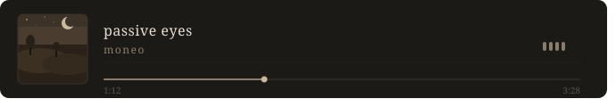

# Olá! 👋 Eu sou Ryan — Estudante de Análise e Desenvolvimento de Sistemas

> Estudante de tecnologia, desenvolvendo habilidades em back-end, front-end e dados.

---

## 🧑‍💻 Sobre mim

- 🎓 Estudante de **Análise e Desenvolvimento de Sistemas**
- 💻 Desenvolvendo projetos com **Java, Python, JavaScript e React**
- 🎨 Habilidades em design com **Photoshop**
- 📍 São Paulo, Brasil
- 🚀 Sempre aprendendo e buscando novos desafios

---

## 🛠️ Tecnologias & Ferramentas

---

---

## 📊 Estatísticas

  
  &nbsp;&nbsp;&nbsp;&nbsp;
  

---

## 📬 Contato

---

  

